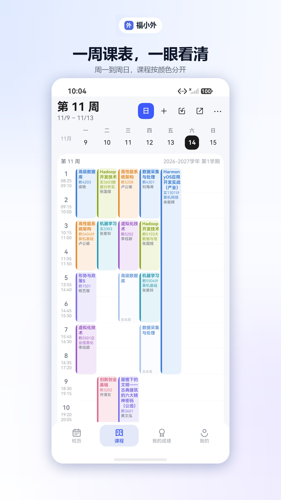
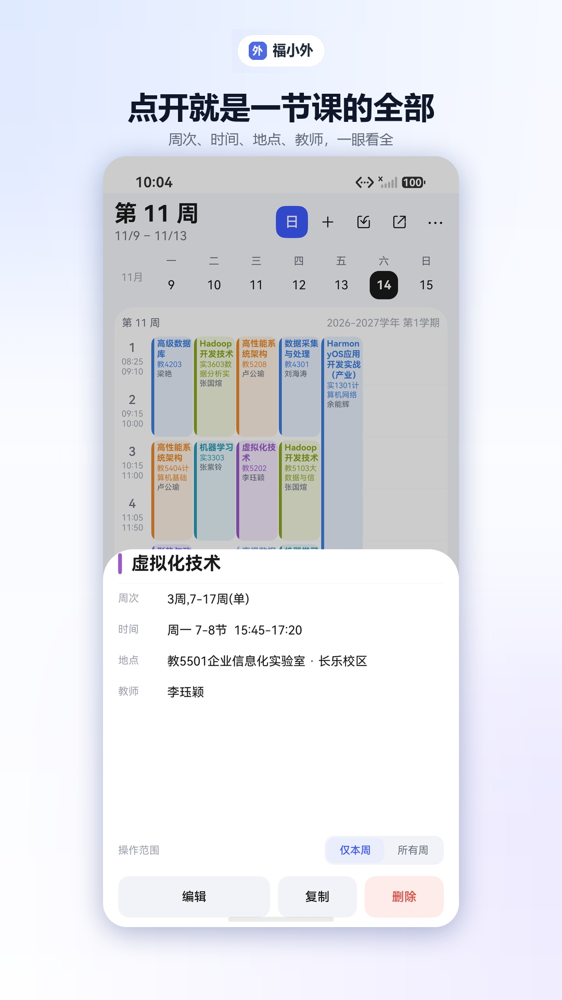
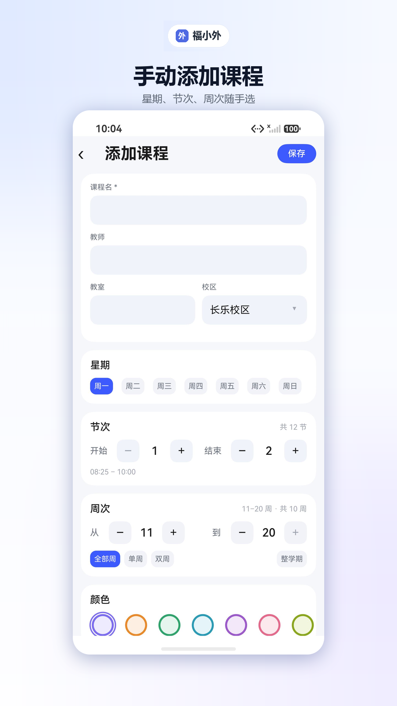
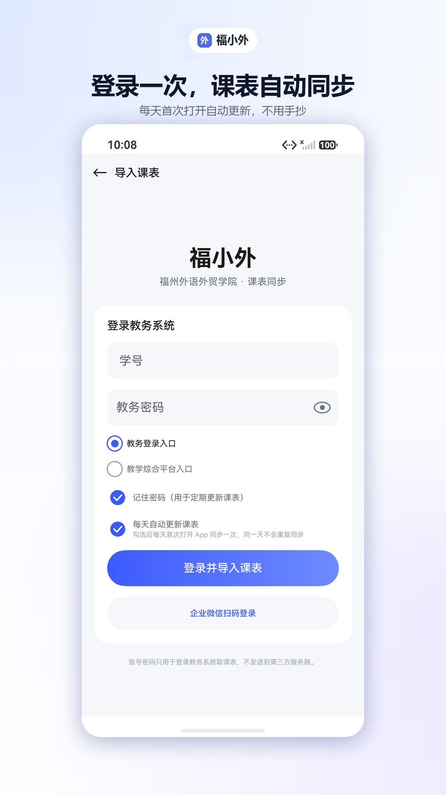
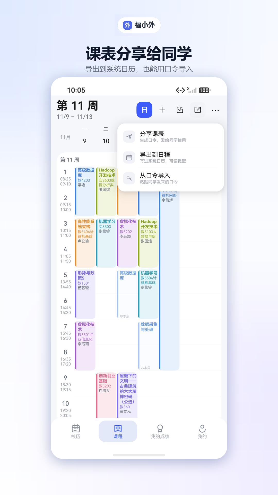
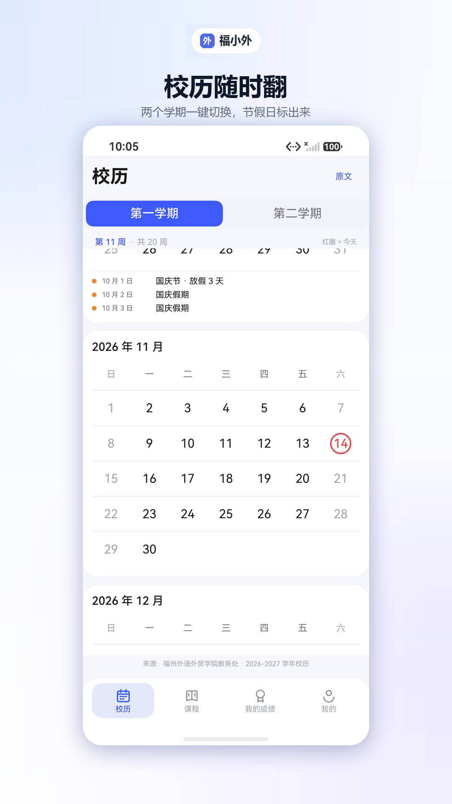
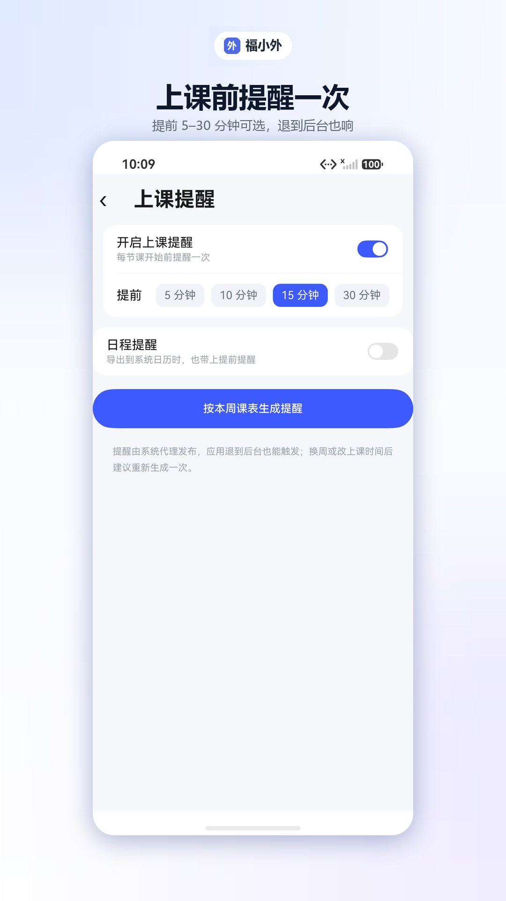
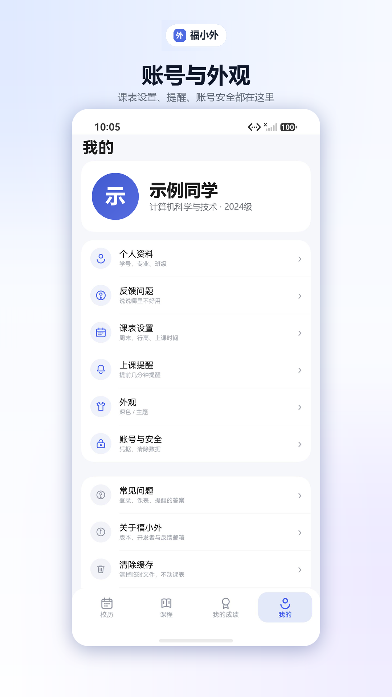
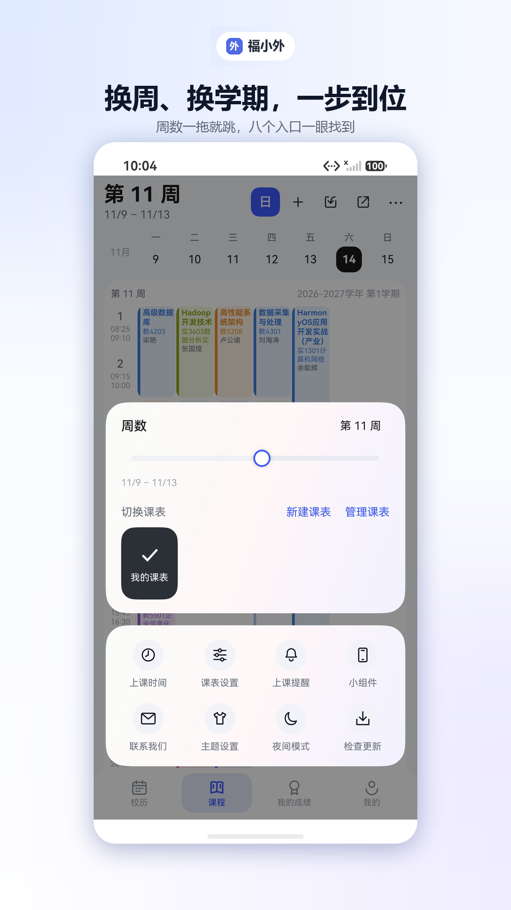
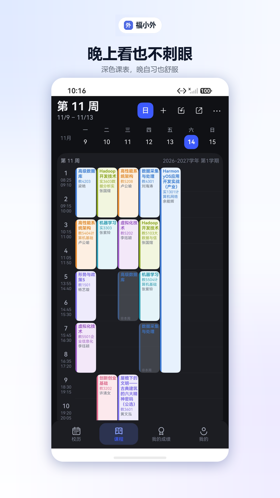

<div align="center">


# 福小外 · 福州外语外贸学院课表软件

**面向福州外语外贸学院学生的课表管理工具 —— 数据只保存在你自己的手机上**

-0A59F7?logo=harmonyos&logoColor=white)

-success)

-lightgrey?logo=android&logoColor=white)


[界面预览](#界面预览) · [主要功能](#主要功能) · [第一版做了什么](#第一版做了什么) · [仓库结构](#仓库结构) · [Android 版本预留](#android-版本预留) · [构建与运行](#构建与运行) · [发布说明](#版本与发布)

</div>

---

## 这是什么

**福小外** 把一学期的课表收进手机：周视图一屏看全一周，点开课程就是全部信息；主页收敛成一个「三点菜单」——周数一拖就跳、课表一键切换、八个常用入口一眼找到。课程可以手动录入，也可以用一个 **32 位口令**和同学互换，没登录教务也能先导入游客课表试用。你可以把课表导出到系统日历、设置上课提醒，或者在桌面放一张「今天的课」卡片。所有信息都保存在本机，卸载即清空。

> **当前发布形态：HarmonyOS 原生应用（ArkTS / Stage 模型）**
> 本项目从第一天就是按鸿蒙开发的，Android 端尚未实现，仓库里以 `android/` 目录预留给后续移植 —— 详见 [Android 版本预留](#android-版本预留)。

| 项目 | 信息 |
| --- | --- |
| 应用名称 | 福小外 · 课表助手 |
| 包名 | `com.fuxiaowai.timetable` |
| 适配平台 | HarmonyOS 5.0.0 (API 12)，Stage 模型，手机 / 平板 |
| 开发语言 | ArkTS（ArkUI 声明式开发范式） |
| 当前版本 | **0.1.1（第一版）** |
| 体积 | 安装包约 1.47 MB |
| 价格 | 免费，无广告、无内购 |
| 开发者 | 个人开发者（独立开发） |
| 分享服务 | `http://113.45.242.182`（备案期直连 IP，反馈仍走 `https://fuxiaowai.xyz`） |

---

## 界面预览

截图取自应用真实运行界面（示例数据，已隐去第三方个人信息）。原始尺寸 1080×1920。

<table>
<tr>
<td align="center"><br><b>周视图</b><br>一屏看全一周</td>
<td align="center"><br><b>课程详情</b><br>周次/时间/地点/教师</td>
<td align="center"><br><b>手动添加</b><br>单双周、连堂课</td>
</tr>
<tr>
<td align="center"><br><b>教务导入</b><br>登录教务系统同步</td>
<td align="center"><br><b>口令分享</b><br>32 位口令互换课表</td>
<td align="center"><br><b>校历</b><br>教学周与节假日</td>
</tr>
<tr>
<td align="center"><br><b>上课提醒</b><br>可导出到系统日历</td>
<td align="center"><br><b>我的</b><br>资料与设置</td>
<td align="center"><br><b>三点菜单</b><br>周数滑块 + 八入口</td>
</tr>
<tr>
<td align="center"><br><b>深色模式</b><br>跟随系统</td>
<td align="center" colspan="2"><i>更多素材见 <a href="harmonyos/assets/design/store">harmonyos/assets/design/store</a>（含 1024 应用图标与商店预览图）</i></td>
</tr>
</table>

---

## 主要功能

### 课表查看
周视图与日视图，左右滑动切换一周、上下滑动切换学期；支持深色模式与自定义主题色。

### 三点菜单（第一版改版）
主页只保留标题、日期、课表与底部导航，其余入口全部收进右上角「⋯」：上半张卡片是**周数滑块**（拖动时只跟手、松手才刷新课表）与**课表切换/新建/管理**，下半张是**八个入口**（上课时间、课表设置、上课提醒、小组件、联系我们、主题设置、夜间模式、检查更新）。二级页面打开时菜单自动关闭，小屏可滚动。

### 手动添加课程
课程名、教师、教室、校区、星期、节次、周次与颜色，一次填完；支持单双周、连堂课。

### 口令分享与游客导入
把课表压成一个 **32 位口令**发给同学，对方粘贴即可导入；口令 30 天有效。分享上传与口令查询直连分享服务（`http://113.45.242.182`），反馈仍走 `https://fuxiaowai.xyz`。支持**整段分享文案粘贴自动识别**、多码拒绝、重复同码允许；未登录教务也可先导入「游客课表」，登录学校教务并成功取得课表后**在同一事务里**替换游客课程（失败则完整回滚，不清数据）。

### 教务系统同步
登录学校教务系统（正方 `jwglxt` / CAS 统一身份认证 / 企业微信扫码）后一键导入本学期课程、成绩与考试安排。第一版重写了跳转与票据链路：301/302/303 转 GET、307/308 保留方法、外部跳转拒绝、**只有 HTTP 200 + 合法 JSON + `kbList` 数组才算成功**，失败不落库。

### 校历
按学期展示教学周与节假日，日期字号与周分割线重做，随时对照「现在是第几周」。

### 成绩查询
查看成绩、学分与绩点统计，本地缓存，支持多学期对比。

### 考试安排
汇总本学期考试时间与地点，和课表放在同一处。

### 上课提醒
按本周课表生成提醒，可提前 5 / 10 / 15 / 30 分钟；也可整学期导出到系统日历（写入前先读，避免重复）。

### 桌面小组件
「今天的课」卡片放在桌面，不打开应用也能看到下一节课。

---

## 第一版做了什么

第一版（0.1.1）在 2026-11-14 做了一轮整体打磨，逐条根因/修复/验证记录见 [`harmonyos/Solution.md`](harmonyos/Solution.md) 与 [`harmonyos/docs`](harmonyos/docs)。

| 主题 | 变更 |
| --- | --- |
| **三点菜单** | 主页瘦身，周数/课表切换/八入口收进双卡片菜单；补 7 个线性图标，菜单图标改为 `Stack` 居中 |
| **周数滑块** | 拖动只预览、松手提交；去掉 `Swiper.onChange` 重复刷新，加请求代次校验 |
| **口令分享** | 分享直连 IP、反馈保持 HTTPS；整段文案解析、防抖查询、离页废弃旧结果 |
| **游客导入** | 未登录可先导入；教务成功后同事务替换并清游客数据，失败回滚 |
| **教务认证** | 302 跳转与 CAS 票据链路重写：有限重定向、票据落地校验、旧 Cookie 不再放行 |
| **视觉细节** | 校历字号 13→16 vp 与分割线、星期 9→12 vp、底部标签选中滑动 250 ms、成绩页按压 0.9 弹性 |
| **稳定性** | HUKS `createKey` 的 `12000011` 视为密钥不存在；ArkTS 不支持 `delete` 字典字段改为过滤重建 |
| **管理后台** | 配套 `server/` 新增零依赖后台 v2（口令检测/反馈/探针/告警/审计），仅管理员可访问 |
| **工程规范** | 新增 `AGENTS.md` 验收条款（改动必须装模拟器停在目标页）、9 份工程地图全量重写 |

---

## 技术栈

| 层 | 选型 |
| --- | --- |
| UI | ArkUI 声明式组件，Navigation + 自定义主题 Token |
| 语言 | ArkTS（严格模式，`useNormalizedOHMUrl`） |
| 状态与装配 | `ServiceLocator`（DI 容器）+ 状态存储 `*Store` 类 |
| 本地存储 | RDB（关系型数据库）+ Preferences，DAO 分层 |
| 网络 | `@ohos.net.http` 封装（Cookie 管理、RSA 加密、gzip 解压） |
| 认证 | 正方 jwglxt / CAS / 企业微信扫码 三套适配器 |
| 系统能力 | 日历读写、提醒代理、Form（桌面卡片）、相册选择器 |
| 构建 | hvigor + hvigorfile.ts，`build-profile.json5` 双 buildMode（debug / release） |
| 测试 | 26 个 Node 测试文件（`tests/*.cjs`），77 通过 / 1 跳过；对 OHOS 边界使用替身 |
| 服务端 | Node.js 零依赖（`server/server.js` + `server/admin-console.js`）：口令分享、反馈、管理后台、站点托管 |

**架构分层**（`harmonyos/entry/src/main/ets/`）：

```
entryability/   应用入口 EntryAbility
app/            DI 容器 ServiceLocator、路由
domain/         领域模型与仓储接口（7 个）
data/           本地 RDB/Preferences（27 个）、远端数据源与认证适配（正方/CAS/企微）
network/        HTTP 原始封装、Cookie、压缩、RSA
ui/             可复用组件（11 个）：课表网格、三点菜单、底部标签、日程卡片等
pages/          23 个页面：周视图、日视图、添加课程、成绩、考试、校历、我的…
widget/         桌面卡片（今天的课）
common/         工具与通用配置（含检查更新入口 UpdateCheck）
```

---

## 仓库结构

```
Fuxiaowai/
├── harmonyos/                       # 鸿蒙工程（当前唯一实现，0.1.1 第一版）
│   ├── AppScope/                    # 应用级配置与图标
│   ├── entry/                       # 主模块：ets 源码 + resources + test/ohosTest
│   ├── assets/                      # 商店素材（design/store）、线框图、素材脚本；dev 文档默认不入库
│   ├── docs/
│   │   ├── map/                     # 工程地图 9 份：模块/页面/接口/数据库/构建/状态
│   │   ├── superpowers/plans/       # 5 份实施计划（后台/302/分享/菜单/周滑块）
│   │   └── *-20261114.md            # 4 份改造验收记录
│   ├── server/                      # 配套后端：口令分享、反馈、管理后台、官网静态页
│   ├── tests/                       # Node 侧测试（26 个 .cjs）
│   ├── tools/                       # 构建 / 打包 / 验包 / 后台部署脚本
│   ├── Solution.md                  # 问题解决记录（根因·修复·验证证据）
│   ├── AGENTS.md                    # 开发约定（含模拟器验收强制条款）
│   ├── build-profile.json5          # 构建配置（compatibleSdkVersion 5.0.0(12)）
│   └── oh-package.json5             # 包信息（name: fuxiaowai, version 0.1.1）
│
├── android/                         # ⏳ 未来 Android 工程，现阶段仅预留（见其 README）
├── docs/
│   ├── screenshots/                 # README / Release 用截图（取自 design/store）
│   └── release-notes/               # 各版本发布说明
└── README.md
```

> 说明：签名材料（`*.p12` / `*.p7b` / `*.csr` / `*.cer` / `*.pem`）、构建产物（`*.hap` / `*.app`）、
> `oh_modules/` / `node_modules/` / `build/` / `dist/` / `.hvigor/` / `_tmp/` 均已在 `.gitignore` 中排除，不会进入仓库。

---

## Android 版本预留

本项目**并非跨平台框架产物**，鸿蒙端为原生 ArkTS 实现。为了给后续移植留出清晰边界，仓库采用「一个仓库、多端目录」的结构：

```
harmonyos/   # 当前鸿蒙工程（第一版 0.1.1）
android/     # 未来 Android 工程，现阶段仅预留占位
```

`android/` 目录现阶段**只有一份说明文档，没有可编译代码**。后续 Android 版计划：

| 阶段 | 目标 |
| --- | --- |
| 1. 领域模型对齐 | 复用 `harmonyos/entry/src/main/ets/domain` 的课程/学期/成绩模型定义，保持字段语义一致 |
| 2. 数据层移植 | 课表 RDB 结构与口令分享协议（32 位口令、30 天有效期）保持与鸿蒙端互通 |
| 3. UI 重写 | 用 Jetpack Compose 重写页面，视觉规范参照鸿蒙端组件地图 [`harmonyos/docs/map/COMPONENT_MAP.md`](harmonyos/docs/map/COMPONENT_MAP.md) |
| 4. 系统能力映射 | 日历导出→CalendarContract，提醒→AlarmManager/WorkManager，桌面卡片→App Widget |

两端共享的口令协议与后端接口（`harmonyos/server/`）不区分平台，Android 端接入同一套即可实现**鸿蒙 ↔ Android 互相导入课表**。

---

## 构建与运行

环境要求：**DevEco Studio 5.0+**、HarmonyOS SDK 5.0.0 (API 12)、Node.js（hvigor 依赖）。

```powershell
cd harmonyos
# 依赖安装（如首次拉取）
ohpm install

# Debug 构建
hvigorw assembleHap --mode module -p product=default -p buildMode=debug

# Release 构建（需先在 build-profile.json5 配好 signingConfigs）
hvigorw assembleApp --mode project -p product=default -p buildMode=release
```

> **工程在中文路径下**：`hvigor` 会报 `00306003 Invalid project path`，因此仓库提供
> `tools/构建.ps1`，它先把工程镜像到 ASCII 目录（默认 `D:\fxw_build\hardening\HarmonyOs`）
> 再构建，并输出 `dist/build-manifest.json`（源码逐文件 SHA-256 + 构建时间）。

**测试**：

```powershell
cd harmonyos
& 'D:\DevEco Studio\tools\node\node.exe' --test 'tests/*.cjs'
```

> Node 测试通过只代表纯逻辑正确，**不能替代** ArkTS 编译、真机与校园网认证验证。

构建与签名的完整说明见 [`harmonyos/docs/map/BUILD_MAP.md`](harmonyos/docs/map/BUILD_MAP.md)。

> 工程内部的 69 份开发文档（`harmonyos/assets/docs/`，01-UI规格 … 57-兼容加固实施记录）默认按项目自身的 `.gitignore` 规则**不入库**，
> 只有 `57-兼容加固实施记录.md` 被显式放行；需要完整设计文档可向作者索取。

---

## 版本与发布

| 版本 | 日期 | 说明 |
| --- | --- | --- |
| **0.1.1（第一版）** | 2026-11-14 | 三点菜单 / 周数滑块 / 口令分享与游客导入 / 302 与票据加固 / 后台 v2；安装包见 [Releases](../../releases) |
| 0.1.1（初版） | 2026-11 | 兼容性加固（Cookie、RSA 登录参数、数据库迁移健壮性），深色模式对比度修正 |
| 0.1.0 | 2026-10 | 首个可上架版本：课表/成绩/考试/校历/提醒/小组件 |

鸿蒙版安装包（`.hap`）与上架用应用包（`.app`，因 GitHub 后缀限制以 `.zip` 提供）在 [**Releases**](../../releases) 页面提供；正式安装请前往**华为应用市场**搜索「福小外」。

**本次产物校验**（0.1.1 第一版）：

| 文件 | 大小 | SHA-256 |
| --- | --- | --- |
| `Fuxiaowai-0.1.1-harmonyos.hap` | 1 503 288 B | `123E78B88788B8C8E19DB469A99163363112FBD29FF181E4128E84BA5EDC18E5` |
| `Fuxiaowai-0.1.1-harmonyos-app.zip` | 973 918 B | `59F8ED979394EA094594F16B6458B95A656DFC9B458FA87A38644B0D38542855` |

---

## 数据与隐私

- 课表、成绩、个人资料与设置**全部保存在应用私有目录**，不上传服务器。
- 仅在你主动点「分享课表」时，才会把课表快照临时存到口令服务（`http://113.45.242.182`），**口令 30 天后自动失效**。
- 仅在你主动点「提交反馈」时，才会把反馈文字、联系方式与所附图片发送到服务端（`https://fuxiaowai.xyz`）。
- 配套管理后台只对管理员账号开放（HTTP Basic 认证 + 同源写保护），不对外提供任何公共接口。
- 卸载应用即清空全部本地数据。
- 本仓库与发布产物**不含开发者个人信息**：姓名 / 学号 / 邮箱 / 签名证书 / 华为审核自测材料均已移除或替换为中性值（应用包 `vendor` 为 `fuxiaowai`）。

**权限说明**：

| 权限 | 用途 | 是否可拒绝 |
| --- | --- | --- |
| 网络 | 登录学校教务系统、口令分享与提交反馈 | 拒绝后无法同步课表与成绩 |
| 通知 / 提醒代理 | 上课提醒 | 可拒绝，仅影响提醒 |
| 日历（读、写） | 把课表导出到系统日历，写入前先读以避免重复 | 可拒绝，仅影响导出 |
| 相册与文件（按需） | 更换头像、反馈时附加截图，由系统选择器单选 | 可拒绝，仅影响选图 |

---

## 免责声明

本应用为**个人开发的学习辅助工具**，与福州外语外贸学院及任何学校官方无关。课表与成绩数据来自你**自行登录**的学校教务系统，请勿用于任何商业用途或大规模抓取。使用本工具造成的课表误差、成绩显示异常等，以学校教务系统原始数据为准。

---

<div align="center">

**福小外 · 课表助手** ｜ HarmonyOS 0.1.1 第一版 ｜ Android 版本预留中

如果这个项目对你有帮助，欢迎点一个 ⭐ Star

</div>