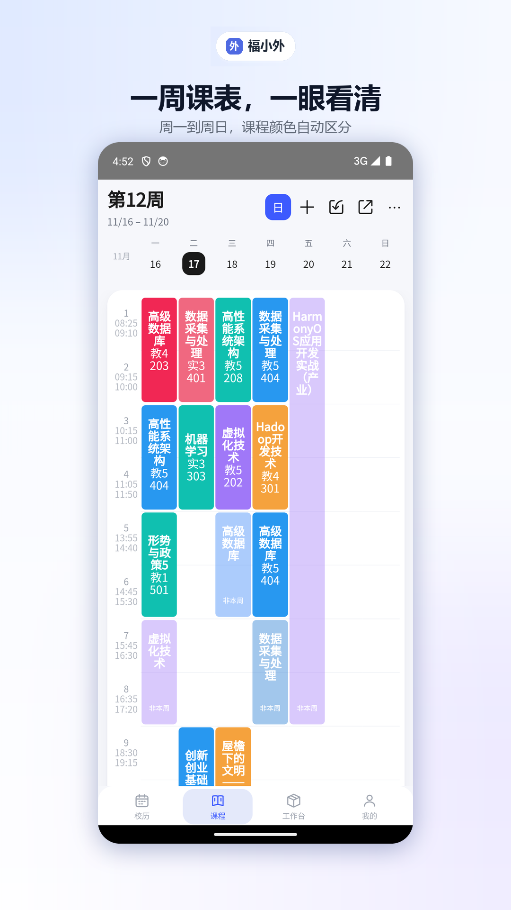
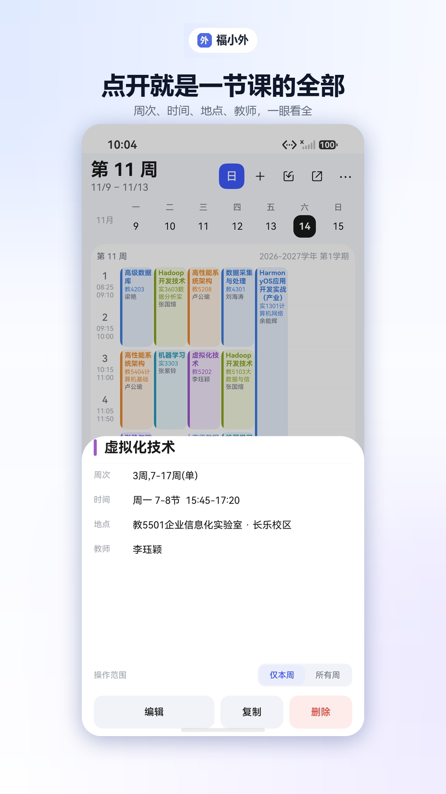
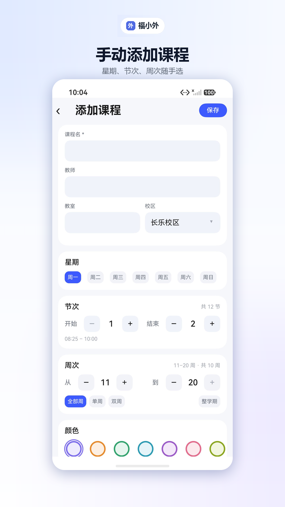
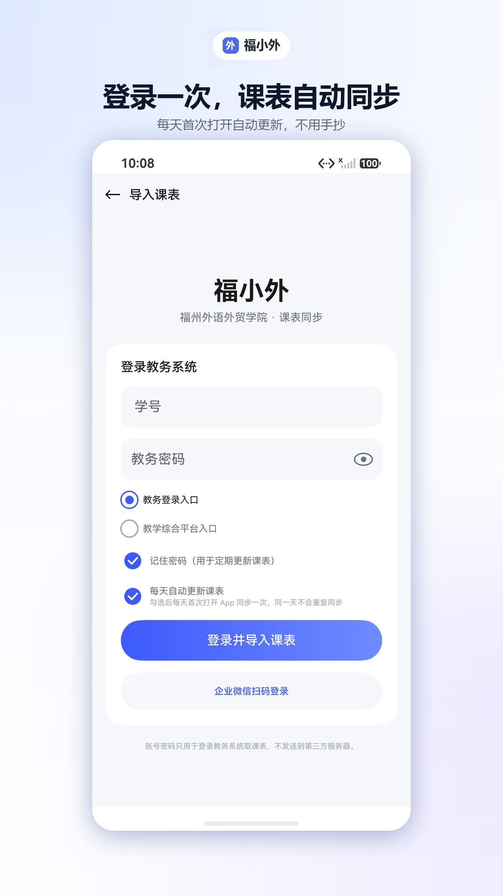
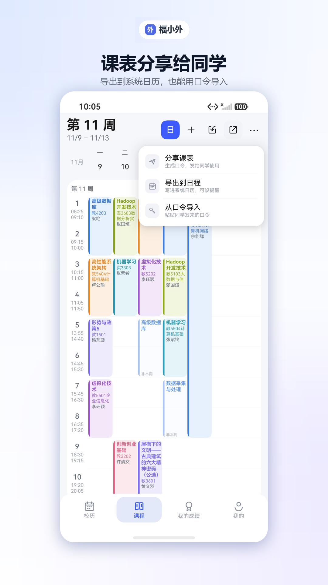
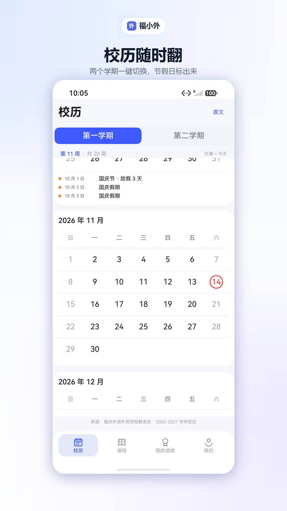
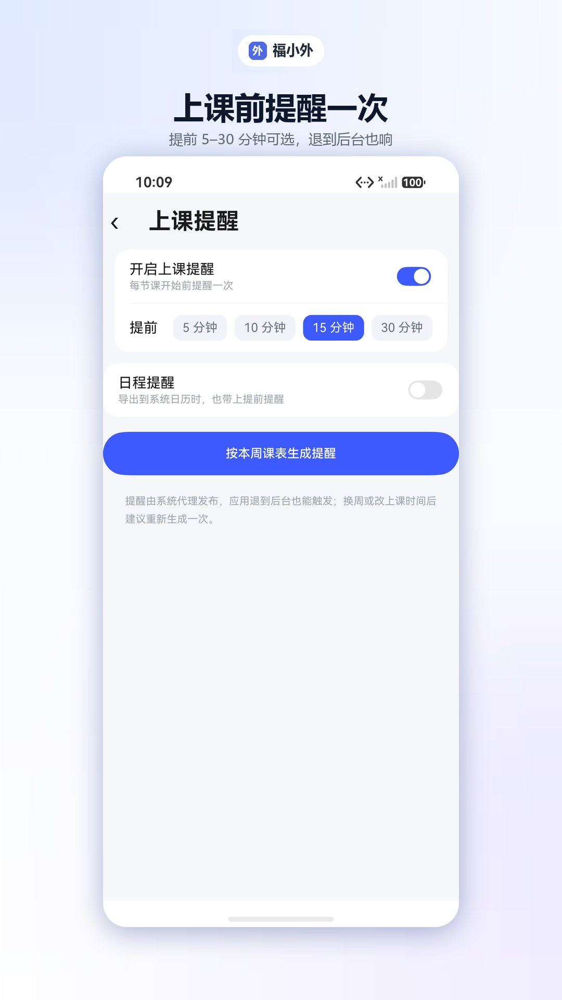
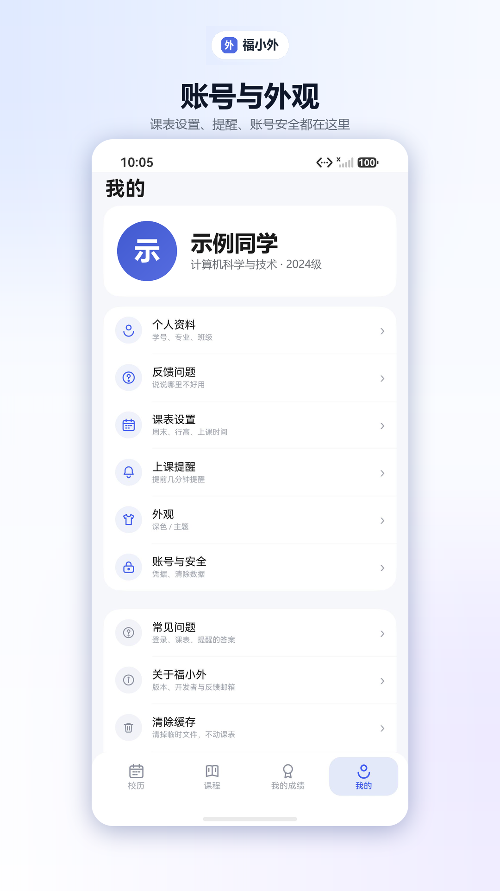
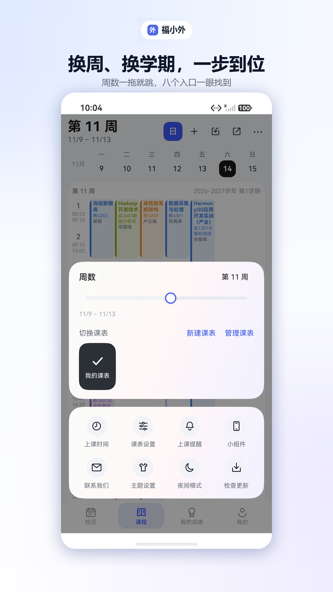
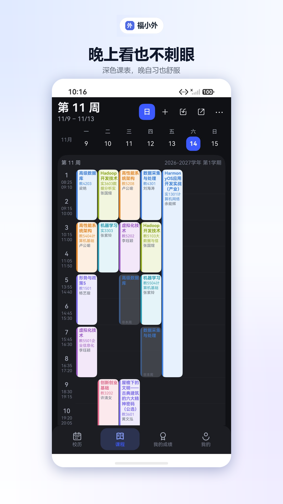

# 福小外 · 安卓版 v0.1.1（versionCode 3）

**福州外语外贸学院课表软件 · Android 版（React + TypeScript / Capacitor）**

-3DDC84)

> 安卓版不是套壳：鸿蒙版的 22 个页面、课表网格排布、三点菜单、课块配色与底部标签滑动，
> 都按像素规格在 Web 层重做，再用 Capacitor 接上系统能力（日历、提醒、桌面小组件、密钥库）。
> 两端共用同一个包名、同一套 32 位口令协议、同一套后端接口 —— **鸿蒙 ↔ 安卓可以互相导入课表**。
> 所有数据只保存在本机，卸载即清空。

---

## ⬇ 下载

| 文件（本 Release 附件） | 大小 | SHA-256 |
| --- | --- | --- |
| `Fuxiaowai-Android-0.1.1.apk` | 4 628 048 B（约 4.41 MB） | `C22D6D288EBC13921AE31C05E6B37E1D47E7131BC5E15BA418A1E8E651CF1229` |

> 本地构建产物名为 `福小外-Android-0.1.1.apk`；GitHub 附件不支持非 ASCII 文件名，故以 `Fuxiaowai-` 前缀上传，内容完全一致（GitHub 侧 digest 与上表 SHA-256 相同）。

**系统要求**：Android 5.1 及以上（`minSdk 22`，`targetSdk 34`；包名 `com.fuxiaowai.timetable`，`versionName 0.1.1`，`versionCode 3`）。

**安装方式**

1. 手机浏览器下载 APK → 允许「安装未知来源应用」→ 安装。
2. 或用 adb（保留旧数据覆盖安装）：`adb install -r Fuxiaowai-Android-0.1.1.apk`。

> ⚠️ 本版产物是 **Debug 验收包**：使用 Android 调试密钥签名（v1 + v2 校验已通过），面向功能验收与内测安装，**不适合长期分发**。
> 仓库不存放任何签名材料（`*.jks` / `*.keystore` / `keystore.properties` 均已忽略）。正式发行包需用外部签名材料（`FXW_SIGNING_PROPERTIES`）执行 `assembleRelease`，
> 缺失时构建会直接失败，**不会生成替代密钥**。因此本包无法覆盖安装到将来正式签名版本上（需先卸载）。

---

## 🖼 界面预览

界面与鸿蒙版按同一套规格复刻（同一页面、同一配色、同一交互时长），因此截图一致；截图取自应用真实运行界面（示例数据，已隐去第三方个人信息）。

<table>
<tr>
<td align="center"> <b>周视图</b> 一屏看全一周</td>
<td align="center"> <b>课程详情</b> 点开就是一节课的全部</td>
<td align="center"> <b>手动添加</b> 单双周、连堂课</td>
</tr>
<tr>
<td align="center"> <b>教务导入</b> 登录教务一键同步</td>
<td align="center"> <b>口令分享</b> 32 位口令互换课表</td>
<td align="center"> <b>校历</b> 教学周与节假日</td>
</tr>
<tr>
<td align="center"> <b>上课提醒</b> 也可导出到日历</td>
<td align="center"> <b>我的</b> 资料与设置</td>
<td align="center"> <b>三点菜单</b> 周数一拖就跳</td>
</tr>
<tr>
<td align="center"> <b>深色模式</b> 跟随系统</td>
<td align="center" colspan="2"><i>安卓版逐页对齐过程见 <a href="https://github.com/kmmiku/Fuxiaowai/tree/main/android/Map">android/Map</a></i></td>
</tr>
</table>

---

## ✨ 这一版做了什么

| 主题 | 交付内容 |
| --- | --- |
| **页面复刻** | 22 个页面 + 21 条精确路由 + `/privacy/` 前缀页；底部四标签（课程表 / 首页 / 成绩 / 我的）选中背景 250 ms `cubic-bezier(0.22,1,0.36,1)` 滑动；物理返回键在首页退出应用。 |
| **账号隔离存储** | 每个账号、每张课表一个独立 `localStorage` 命名空间（一个 JSON 数组），外部 `Course.id` 保持不变；持久 undo 日志 + 整表快照（`restoreLastTimetable`）保证写失败可回滚、旧表可恢复；换账号不再串号。 |
| **教务登录** | 原生 WebView 登录窗口（`PortalLoginActivity`）+ `onJsPrompt` 通道回传，来源校验只接受 `https://localhost`；正方 `jwglxt` / CAS / 企业微信扫码三通道；登录返回学号与输入不一致时立即中止；凭据经 `SecretVault`（Android Keystore）加密，API 22 上用 RSA 包裹 AES，密文不可解密时保留密文、不降级写明文。 |
| **课块与配色** | 15 px 白字、纯色填充、整组居中；八色调色板（红 `hsl(346.67,88%,55%)`、橙 `hsl(33.1,90%,60%)`、深蓝 `hsl(210,80%,45%)` 等）；翻周颜色一次性冻结（`autoColorIndex`），刷新、重启、换账号都不重新分配。 |
| **口令分享与游客导入** | 32 位口令、30 天有效、整段分享文案自动识别、多码拒绝 / 同码允许；分享走 `http://113.45.242.182`（备案期直连 IP），反馈走 `https://fuxiaowai.xyz`；未登录可先导入游客课表，正式登录成功后同事务替换，失败完整回滚。 |
| **校历 / 提醒 / 小组件** | 校历按学期展示教学周与节假日；提醒按本周课表生成（提前 5 / 10 / 15 / 30 分钟）或整学期写入系统日历（`CalendarContract`，写入前先查重）；桌面「今天的课」App Widget 不打开应用也能看下一节课。 |
| **成绩与考试** | 成绩按学号分账号本地缓存（权限过期或离线仍可看上次结果），绩点统计与多学期对比；考试汇总时间地点，附 Web 兜底页。 |
| **检查更新与双平台版本** | 客户端「检查更新」走原生 `UpdateLinkPlugin`，**只接受 HTTPS** 更新入口；配套后端新增 `GET/PUT /api/admin/app-version?platform=android|harmony` 与 `app-update` 平台隔离接口，安卓与鸿蒙各自登记版本与公告，撤回公告不删除版本记录。 |
| **质量门禁** | 56 个 Node 用例全通过；22 页 UI 源码合同（结构 / 文案 / 尺寸断言）；390×844 浅色 + 320×844 深色共 40 组截图比对，其中 5 组复测逐字节一致；`assembleDebug` / `testDebugUnitTest` / `assembleAndroidTest` 均成功，隔离 Android 34 AVD 上 4 项 instrumentation 通过。 |

**验证口径**：`node --test tests/*.test.cjs` → **56 项 / 56 通过 / 0 失败**（约 2.8 s）；
`npm run check` → 测试 + UI 合同 + Web 构建全绿；`npx cap sync android` → Gradle `assembleDebug` 成功，
产物 4 628 048 B、`versionCode 3`、`versionName 0.1.1`、SHA-256 `C22D6D28…CF1229`。

---

## 🆚 与鸿蒙版的关系

| 项目 | 鸿蒙版 | 安卓版（本 Release） |
| --- | --- | --- |
| 包名 | `com.fuxiaowai.timetable` | 同左（同一发布身份） |
| 版本 | 0.1.1（第一版） | 0.1.1 / `versionCode 3` |
| 实现 | ArkTS / Stage 模型（原生） | React + TypeScript Web 层 + Capacitor 6 原生壳 |
| 凭据保管 | HUKS | Android Keystore 包裹 AES |
| 日历 / 提醒 / 卡片 | 日历代理 / 提醒代理 / Form | `CalendarContract` / 本地通知 / App Widget |
| 口令协议 | 32 位口令、30 天有效 | 同左，**两端互相可导入** |

---

## 🔒 数据与隐私

- 课表、成绩、资料、设置**全部存在应用私有存储**（`localStorage`），不上传服务器；卸载即清空
- 登录凭据只在原生 `SecretVault` 内以 Keystore 加密保存；密文不可解密时保留密文，不降级写明文
- 仅在主动「分享课表」时把课表快照临时存入口令服务（`http://113.45.242.182`），**30 天自动失效**
- 仅在主动「提交反馈」时把反馈文字、联系方式与所附图片发送到 `https://fuxiaowai.xyz`
- 桌面小组件与上课提醒只读取本机课表，不联网
- 权限：网络（登录教务 / 口令分享 / 反馈）、通知（提醒）、日历读写（导出）、相册与文件（换头像、反馈附图），除网络外均可拒绝

---

## ⚠️ 已知限制

- 本版是 **Debug 验收包**（调试密钥签名），不适合长期分发；与将来的正式签名版本之间不能覆盖安装
- 真实学校账号的三通道登录（账号密码 / CAS / 企业微信扫码，含图片验证码）**尚未在真实环境完整验收**，目前只验证了结构、跳转与失败路径
- 覆盖升级只在调试签名下验证过；跨签名升级需卸载重装（会清空本地数据）
- 生产环境的口令分享备份 / 恢复演练未执行；未提交任何应用商店审核
- 深色模式「上课提醒」页仍有 1 处 8 px 高度差（约 810 像素），已记录在 [`android/Map/VERIFICATION_REPORT.md`](https://github.com/kmmiku/Fuxiaowai/blob/main/android/Map/VERIFICATION_REPORT.md)

---

## 📄 仓库

- 源码与文档：[github.com/kmmiku/Fuxiaowai](https://github.com/kmmiku/Fuxiaowai)
- 安卓版说明：[android/README.md](https://github.com/kmmiku/Fuxiaowai/blob/main/android/README.md)
- 改造记录与验证证据：[android/Map](https://github.com/kmmiku/Fuxiaowai/tree/main/android/Map)
- 鸿蒙版发布说明：[docs/release-notes/0.1.1.md](https://github.com/kmmiku/Fuxiaowai/blob/main/docs/release-notes/0.1.1.md)

> 本应用为个人开发的学习辅助工具，与学校官方无关；课表与成绩数据来自你自行登录的教务系统。