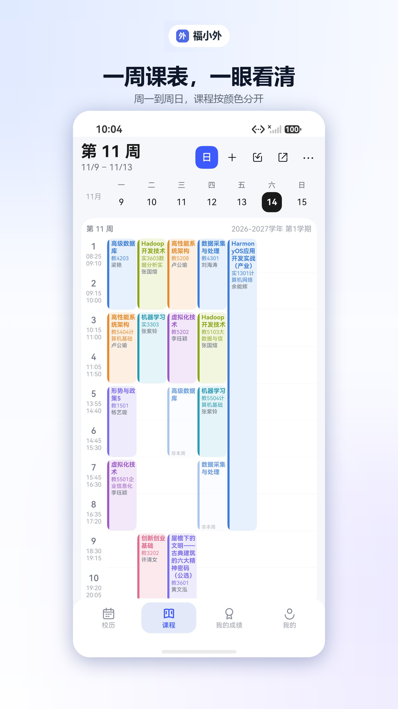
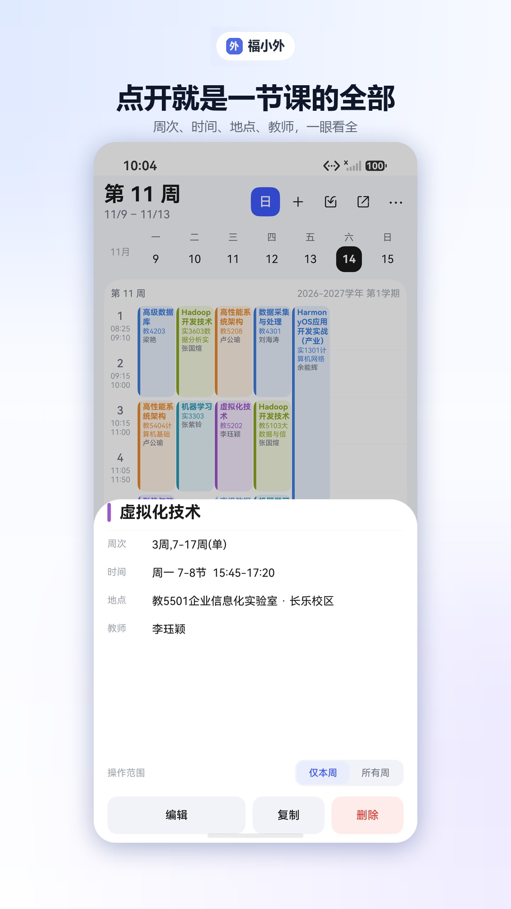
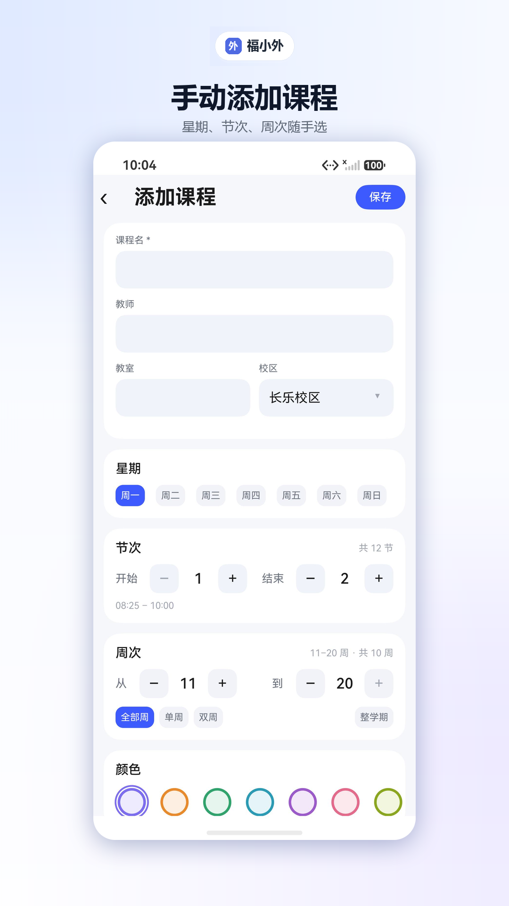
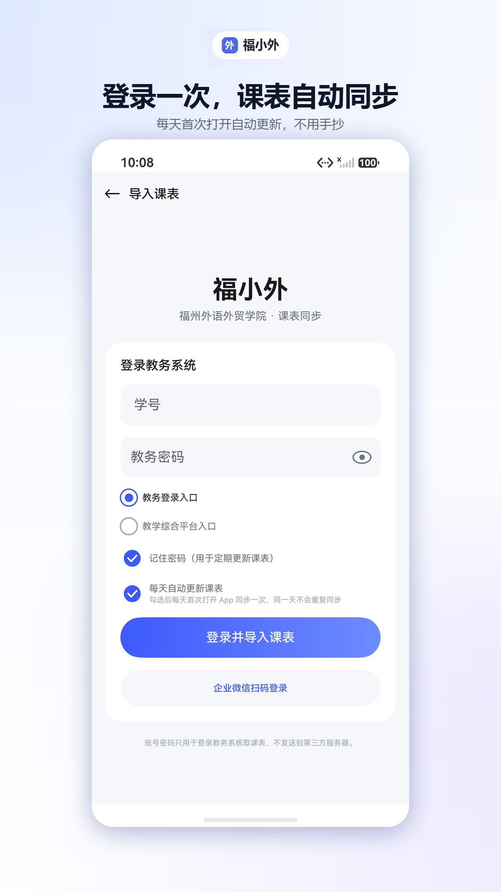
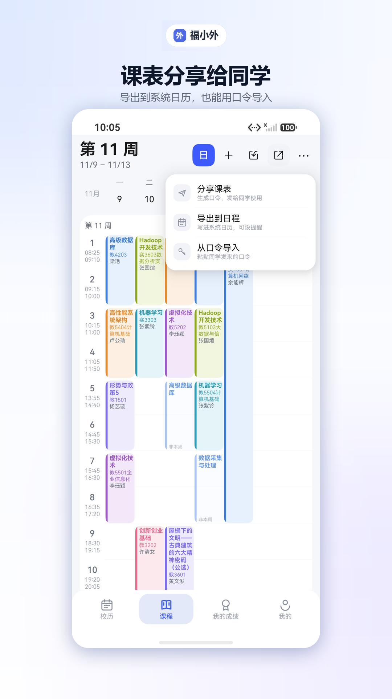
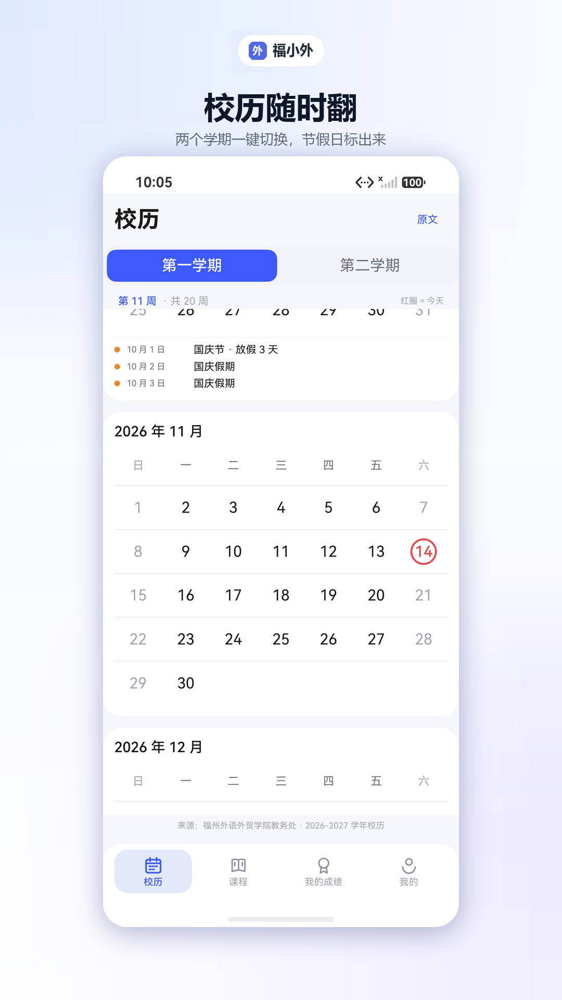
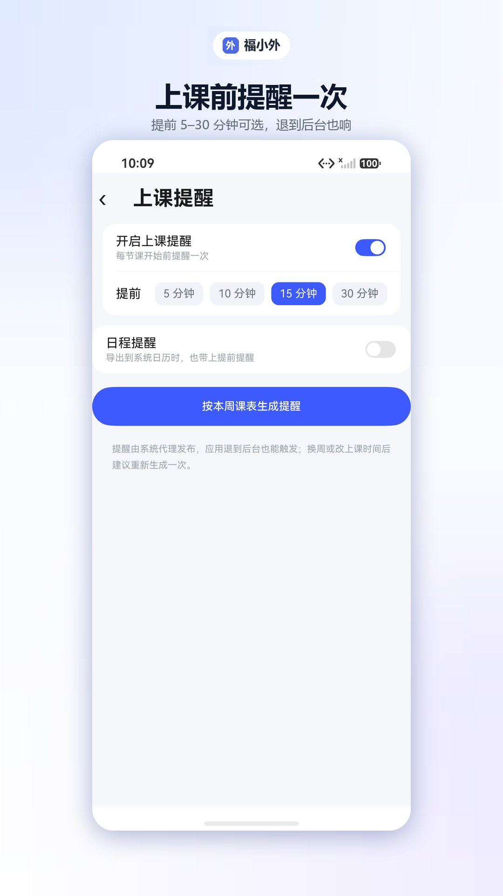
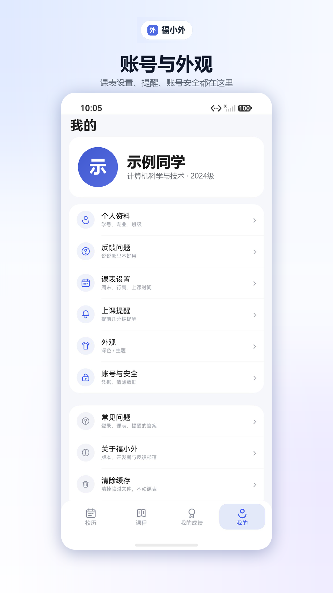
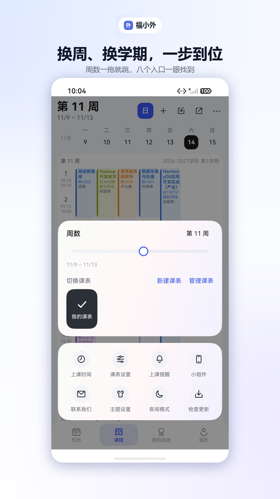
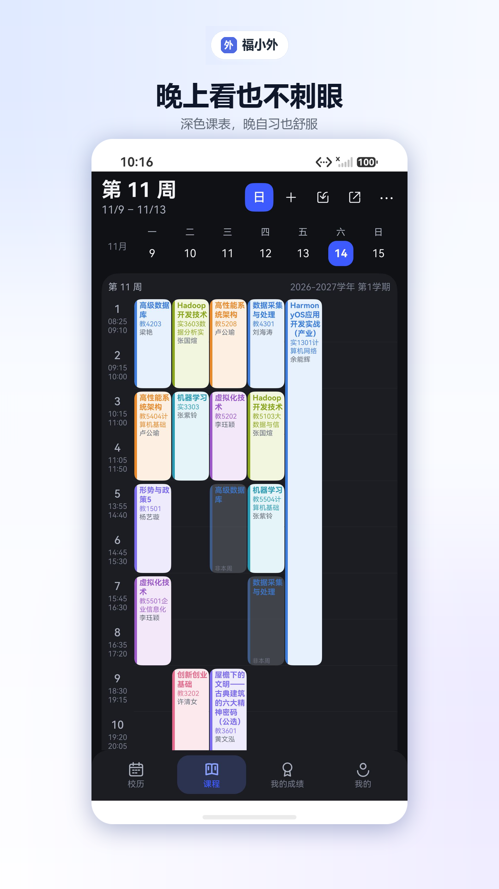

<div align="center">


# 福小外 · 鸿蒙版 v0.1.1（第一版）

**福州外语外贸学院课表软件 · HarmonyOS 原生应用（ArkTS / Stage 模型）**

-0A59F7)


</div>

> 主页只留三样东西：标题、课表、底部导航。其余全收进右上角「⋯」——
> **周数一拖就跳，八个入口一眼找到**。点开一节课，周次、时间、地点、教师一眼看全；
> 课表还能压成 32 位口令和同学互换，没登录教务也能先导入游客课表试试。
> 所有数据只保存在本机，卸载即清空。

这是福小外的**第一个正式版本**（第一版）：代码、文档、后台、测试与商店素材全部就位。

---

## ⬇ 下载

| 文件（本 Release 附件） | 大小 | SHA-256 |
| --- | --- | --- |
| `Fuxiaowai-0.1.1-harmonyos.hap` | 1 503 288 B（约 1.47 MB） | `123E78B88788B8C8E19DB469A99163363112FBD29FF181E4128E84BA5EDC18E5` |
| `Fuxiaowai-0.1.1-harmonyos-app.zip` | 973 918 B（约 0.93 MB） | `59F8ED979394EA094594F16B6458B95A656DFC9B458FA87A38644B0D38542855` |

- `.hap`：鸿蒙安装包，手机 / 平板可直接侧载。
- `.zip`：实为 HarmonyOS 应用打包格式 `.app`（ZIP 容器，内含 `entry-default.hap` + `pack.info` + `pac.json`）。GitHub 不接受 `.app` 后缀，故以 `.zip` 提供；下载后改回 `.app` 即可用于上架提交。

**系统要求**：HarmonyOS 5.0.0（API 12）及以上。

**安装方式**

1. **推荐**：华为应用市场搜索「福小外」安装，可正常接收更新。
2. **侧载调试**：`hdc install Fuxiaowai-0.1.1-harmonyos.hap`（需开发者模式）。

> ⚠️ 本版产物为 **unsigned（未签名）构建**：构建日志明确 `WARN: No signingConfig found for product default`。
> 仓库不存放任何签名材料（`.p12` / `.p7b` / `.csr` / `.pem` 均已忽略）；侧载前请用 DevEco Studio 自备证书重签，
> 或在 `build-profile.json5` 配好 `signingConfigs` 后重新执行 `tools/构建.ps1`。正式分发以应用市场版本为准。

---

## 🖼 界面预览

截图取自应用真实运行界面（示例数据，已隐去第三方个人信息），原始尺寸 1080×1920。

<table>
<tr>
<td align="center"><br><b>周视图</b><br>一屏看全一周</td>
<td align="center"><br><b>课程详情</b><br>点开就是一节课的全部</td>
<td align="center"><br><b>手动添加</b><br>单双周、连堂课</td>
</tr>
<tr>
<td align="center"><br><b>教务导入</b><br>登录教务一键同步</td>
<td align="center"><br><b>口令分享</b><br>32 位口令互换课表</td>
<td align="center"><br><b>校历</b><br>教学周与节假日</td>
</tr>
<tr>
<td align="center"><br><b>上课提醒</b><br>也可导出到日历</td>
<td align="center"><br><b>我的</b><br>资料与设置</td>
<td align="center"><br><b>三点菜单</b><br>周数一拖就跳</td>
</tr>
<tr>
<td align="center"><br><b>深色模式</b><br>跟随系统</td>
<td align="center" colspan="2"><i>高清原图与 1024 应用图标见 <a href="https://github.com/kmmiku/Fuxiaowai/tree/main/harmonyos/assets/design/store">harmonyos/assets/design/store</a></i></td>
</tr>
</table>

---

## ✨ 第一版做了什么

| 主题 | 变更 |
| --- | --- |
| **三点菜单** | 主页瘦身：只留标题、日期、课表与底部导航。右上角「⋯」展开双卡片——上半是**周数滑块 + 课表切换/新建/管理**，下半是**八个入口**（上课时间、课表设置、上课提醒、小组件、联系我们、主题设置、夜间模式、检查更新）。二级页面打开时菜单自动关闭，小屏可滚动；新增 7 个线性图标，菜单图标由改 Canvas 路径改为 `Stack` 居中。 |
| **周数滑块** | 拖动只更新滑块与右上数字（`previewWeek`），松手（End / Click）才提交并刷新课表；用 `requestedWeek` 加请求代次校验，杜绝旧结果覆盖新页面。 |
| **口令分享** | 分享上传与口令查询直连 `http://113.45.242.182`，反馈仍走 `https://fuxiaowai.xyz`。支持**整段分享文案粘贴自动识别**、查询防抖、离页废弃旧结果、32 位 hex 一次性口令 30 天有效；重复同码允许、多码拒绝。 |
| **游客导入** | 未登录教务也可先导入「游客课表」试用；登录学校教务并**成功**取得课表后，在同一事务里替换游客课程，失败则完整回滚、不清数据。 |
| **教务认证加固** | 重写跳转与票据链路：301/302/303 转 GET、307/308 保留方法与请求体、外部跳转拒绝；`CasTicket.mint` 最多一次后重试；**只有 HTTP 200 + 合法 JSON + `kbList` 数组才算成功**，失败不落库；全程校验账号代次。 |
| **视觉与交互打磨** | 校历日期字号 13→16 vp、补周分割线与事件点偏移、星期标题 9→12 vp；底部四标签选中背景 250 ms `cubicBezier(0.22,1,0.36,1)` 滑动；成绩页顶部四按钮 170 ms `springMotion` 按压至 0.9。 |
| **稳定性** | HUKS `createKey` 的 `12000011` 视为「密钥不存在」而非错误；ArkTS 不支持 `delete` 字典字段，改为过滤重建；修复新建课表名称框闪现（两个 `bindSheet` 同宿主冲突，迁移到零尺寸 `Stack` 宿主）。 |
| **配套后台** | `server/` 新增零依赖管理台 v2：口令检测、反馈列表、系统探针（15 s）、异常告警（5xx / 认证失败 / 证书 < 14 天 / 磁盘≥90%）、操作审计（原子写、私有临时文件、写失败重试并暴露 `storageError`），仅管理员可访问。 |
| **工程与文档** | 新增 `Solution.md`（11 条问题的根因·修复·验证证据）、4 份改造验收记录、5 份实施计划、`AGENTS.md` 增加「改动必须在模拟器上验收」条款；9 份工程地图全量重写；测试文件 20 → 26 个。 |

**验证口径**：`node --test 'tests/*.cjs'` → **78 项 / 77 通过 / 1 跳过 / 0 失败**；
`tools/构建.ps1` → `BUILD SUCCESSFUL in 23 s 46 ms`，`42 tasks: 35 executed, 7 up-to-date`，产物时间 `2026-11-14T14:45:17Z`。
包内 `vendor` 已改为中性的 `fuxiaowai`，仓库与发布物均不含开发者个人身份信息（姓名 / 学号 / 邮箱 / 签名证书 / 审核自测材料）。

---

## 📱 关于 Android 版本

本项目从设计之初就是**鸿蒙原生工程**（ArkTS），不是跨平台框架产物。仓库按「一个仓库、多端目录」组织：

```
harmonyos/   ← 当前版本（本 Release，第一版）
android/     ← 未来 Android 工程，现阶段仅预留占位，无可编译代码
```

`android/` 目录目前只有移植规划文档（4 个阶段：领域模型对齐 → 数据层与口令协议 → Compose 重写 UI → 系统能力映射）。
后续计划复用同一套领域模型与口令分享协议，使**鸿蒙 ↔ Android 可以互相导入课表**。
详见 [android/README.md](https://github.com/kmmiku/Fuxiaowai/blob/main/android/README.md)。

---

## 🔒 数据与隐私

- 课表、成绩、资料、设置**全部存在应用私有目录**，不上传服务器
- 仅在主动「分享课表」时把课表快照临时存入口令服务（`http://113.45.242.182`），**30 天自动失效**
- 仅在主动「提交反馈」时把反馈文字、联系方式与所附图片发送到 `https://fuxiaowai.xyz`
- 管理后台只对管理员账号开放（HTTP Basic + 同源写保护），不对外提供公共接口
- 权限均可拒绝：网络（同步）、通知/提醒代理（提醒）、日历读写（导出）、相册（选图）

---

## ⚠️ 已知限制

- 教务系统适配以福州外语外贸学院现行系统为准（正方 `jwglxt` / CAS / 企业微信扫码），学校升级后可能需要同步调整
- 本版产物未签名，侧载需自备证书重签；部分机型需关闭纯净模式
- 桌面卡片刷新受系统节流影响，最长约 30 分钟一次
- 「检查更新」为占位入口：当前仅提示「当前版本 0.1.1，暂未接入在线更新服务」

---

## 📄 仓库

- 源码与文档：[github.com/kmmiku/Fuxiaowai](https://github.com/kmmiku/Fuxiaowai)
- 问题解决记录：[harmonyos/Solution.md](https://github.com/kmmiku/Fuxiaowai/blob/main/harmonyos/Solution.md)
- 工程地图：[harmonyos/docs/map](https://github.com/kmmiku/Fuxiaowai/tree/main/harmonyos/docs/map)

> 本应用为个人开发的学习辅助工具，与学校官方无关；课表与成绩数据来自你自行登录的教务系统。