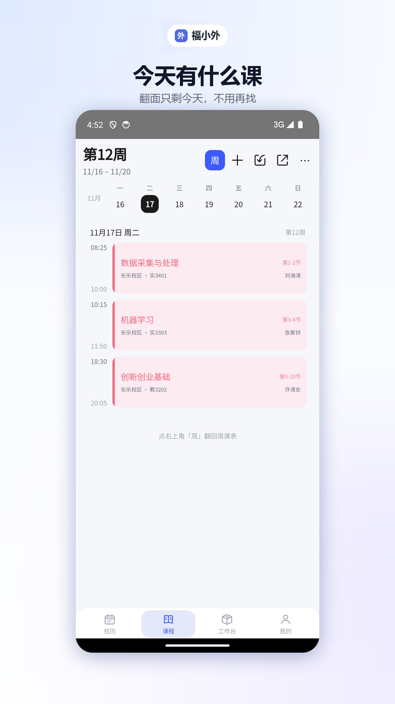
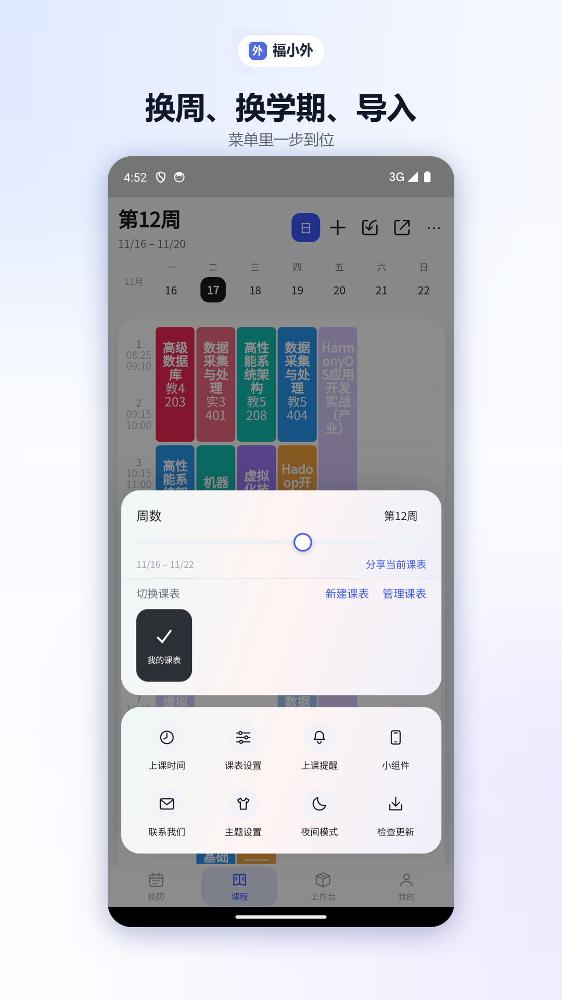
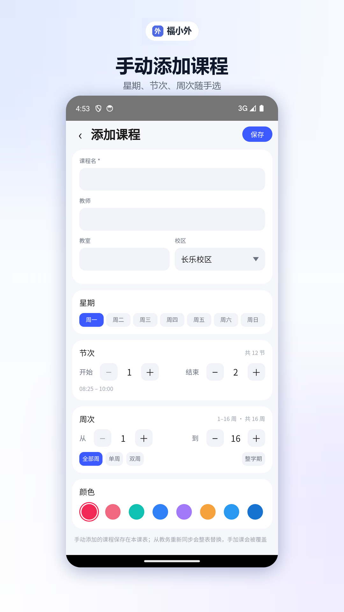
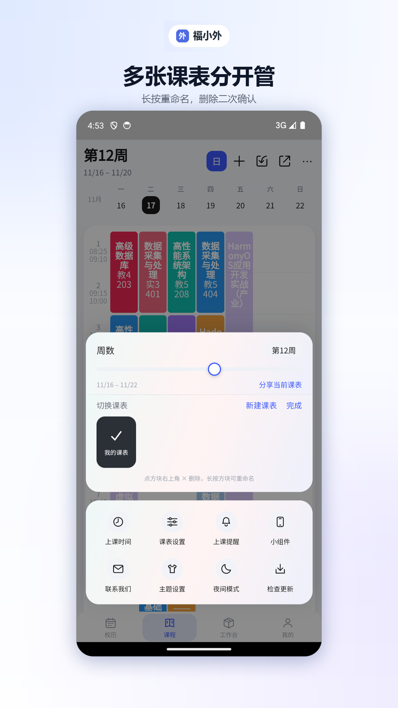
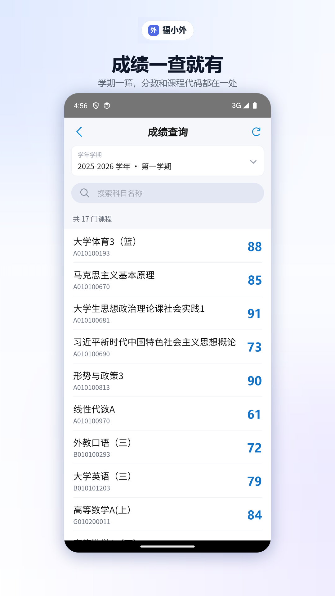
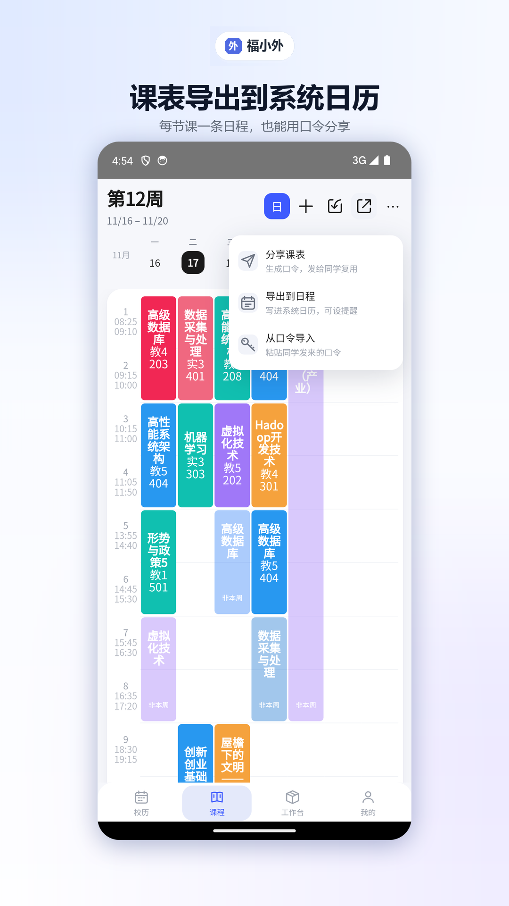
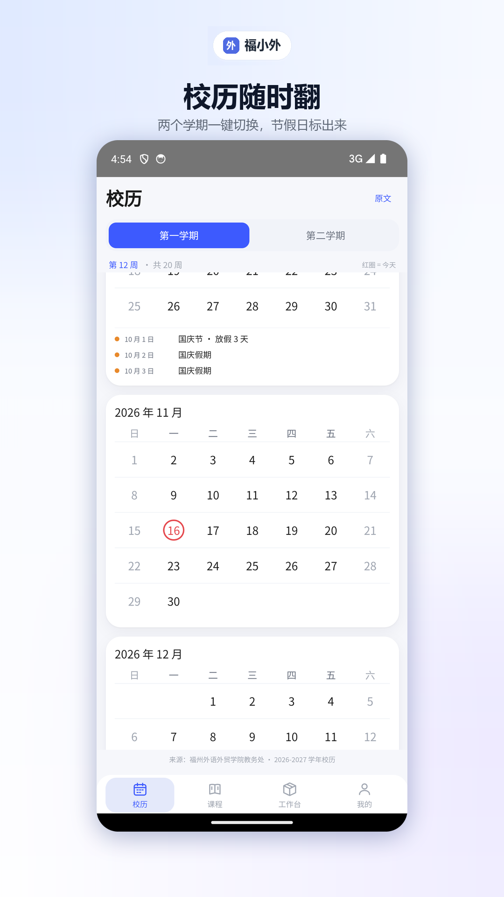
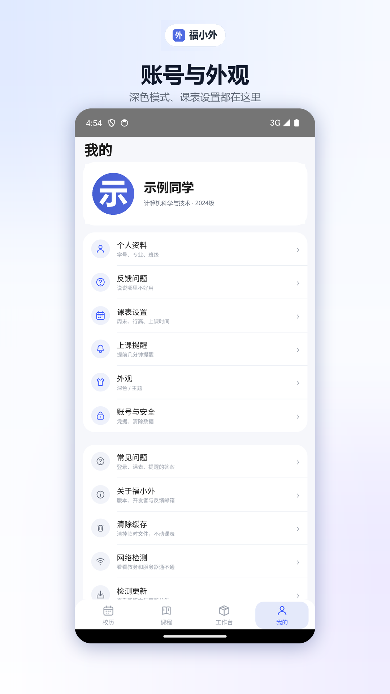
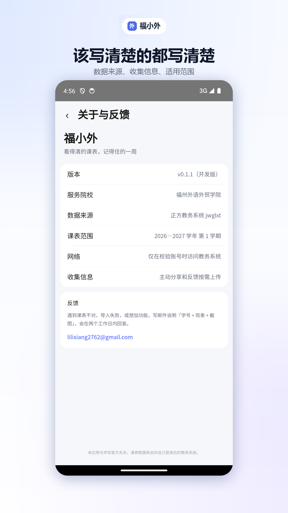

<div align="center">


# 福小外 v0.1.1 · 鸿蒙版 + 安卓版（2026-11-17 交付）

**福州外语外贸学院课表软件 · 鸿蒙原生（ArkTS / Stage 模型）+ 安卓（React + Capacitor）双端同版本发布**

-0A59F7)
-success)


-3DDC84)


</div>

> 主页还是三样东西：标题、课表、底部导航。这一版把「工作台」补齐了——
> **成绩、考试、自主选课、四六级、学院官网**都收进第二屏，登录一次教务就能查；
> 课表列宽改成自适应，长教室号自动拆两行，日视图按上课状态上色；
> 节次时间改用联网校对的北京时间，不再受手机时区影响。
> **这一版两个平台一起发**：鸿蒙与安卓同版本号 0.1.1，功能对齐——工作台、成绩与考试内页、自适应课表宽度、联网校时、启动检查更新都在。
> 所有数据只保存在本机，卸载即清空。

这一版是对 **0.1.1 第一版**（2026-11-14）的后续交付：工作台、成绩与考试内页、课表自适应宽度、联网校时与启动更新，逐条记录见 [harmonyos/Solution.md](https://github.com/kmmiku/Fuxiaowai/blob/main/harmonyos/Solution.md)。

---

## ⬇ 下载

| 文件（本 Release 附件） | 大小 | SHA-256 |
| --- | --- | --- |
| `Fuxiaowai-0.1.1-harmonyos.hap` | 2 987 208 B（约 2.85 MB） | `CE61F9D68C9A14F0966D9EC14412893F877970CA330F883DD0BA44A24E92DE8E` |
| `Fuxiaowai-0.1.1-harmonyos-app.zip` | 2 113 594 B（约 2.02 MB） | `367893C0B2955C719EFC303240DF49DDA9B18CEFC2552D4DCDF843D85598EC6B` |
| `Fuxiaowai-Android-0.1.1.apk` | 10 251 980 B（约 9.78 MB） | `BD96B7690C729109FA4C0D6C47FB89EFB7F094D182E5EADDEB690215F8C98C22` |

- `.hap`：鸿蒙安装包，手机 / 平板可直接侧载，也用于应用市场更新。
- `.apk`：安卓安装包，Android 5.1（API 22）及以上可直接安装；Debug 签名，详见下方[安卓版](#-安卓版-v011)。
- `-app.zip`：实为 HarmonyOS 应用打包格式 `.app`（ZIP 容器，内含 `entry-default.hap` + `pack.info` + `pac.json`）。GitHub 不接受 `.app` 后缀，故以 `-app.zip` 提供；下载后把后缀改回 `.app` 即可用于上架提交。

**系统要求**：HarmonyOS 5.0.0（API 12）及以上；`versionName 0.1.1` / `versionCode 1000001`。

**安装方式**

1. **推荐**：华为应用市场搜索「福小外」安装，可正常接收更新。
2. **侧载调试**：`hdc install Fuxiaowai-0.1.1-harmonyos.hap`（需开发者模式）。

> ✅ 本版产物已用 **AGC 发行 Profile 签名**（`dist/` 内的 `profile.json`、`local.p12` 等签名材料一律不入库）。
> 从旧包覆盖安装时必须使用同一签名，否则系统会要求先卸载旧版本（本地数据会一起清空，升级前请先在应用内导出课表或备份）。

---

## 🤖 安卓版 v0.1.1

安卓端是同一套业务在 **React 18 + TypeScript + Vite** 上重写、用 **Capacitor 6** 装进原生壳的实现，与鸿蒙版功能对齐、界面同一规格。本 Release 内的 `Fuxiaowai-Android-0.1.1.apk` 就是它。

| 项目 | 值 |
| --- | --- |
| 包名 / applicationId | `com.fuxiaowai.timetable`（与鸿蒙版一致） |
| 版本 | `versionName 0.1.1` / `versionCode 3` |
| 系统要求 | Android 5.1（API 22）及以上，targetSdk 34 |
| 体积 | 10 251 980 B（约 9.78 MB） |
| SHA-256 | `BD96B7690C729109FA4C0D6C47FB89EFB7F094D182E5EADDEB690215F8C98C22` |
| 测试 | `node --test tests/*.cjs` 56 项全过；UI 合同覆盖 22 个页面 |

**安装方式**

1. 手机浏览器下载 `Fuxiaowai-Android-0.1.1.apk` 后点击安装（需允许「安装未知来源应用」）。
2. 或用 adb：`adb install -r Fuxiaowai-Android-0.1.1.apk`。

> ⚠️ 这是 **Debug 签名**的验收包（v1/v2 已签名，但不是发布密钥），可直接安装试用，**尚未上架**任何安卓应用商店；后续换上正式签名时不能覆盖升级，需先卸载旧包（本地数据会清空，请先在应用内导出课表）。

安卓端同样包含：工作台（成绩 / 考试 / 自主选课 / 四六级 / 学院官网）、成绩与考试内页、自适应课表宽度与「教5 / 404」两行教室号、当天已下课变蓝的状态色、口令分享与导入、校历、上课提醒、桌面小组件、启动检查更新、深色模式。源码在 [`android/`](https://github.com/kmmiku/Fuxiaowai/tree/main/android)，逐条说明见 [安卓版发布说明](https://github.com/kmmiku/Fuxiaowai/blob/main/docs/release-notes/0.1.1-android.md)。

---

## 🖼 界面预览

截图取自应用真实运行界面（示例数据，已隐去第三方个人信息），原始尺寸 1080×1920。

<table>
<tr>
<td align="center"><br><b>一周课表，一眼看清</b><br>周一到周日，课程颜色自动区分</td>
<td align="center"><br><b>今天有什么课</b><br>翻面只剩今天，不用再找</td>
<td align="center"><br><b>换周、换学期、导入</b><br>菜单里一步到位</td>
</tr>
<tr>
<td align="center"><br><b>手动添加课程</b><br>星期、节次、周次随手选</td>
<td align="center"><br><b>多张课表分开管</b><br>长按重命名，删除二次确认</td>
<td align="center"><br><b>成绩一查就有</b><br>学期一筛，分数与课程代码同屏</td>
</tr>
<tr>
<td align="center"><br><b>导出到系统日历</b><br>每节课一条日程，也支持口令分享</td>
<td align="center"><br><b>校历随时翻</b><br>两学期切换，节假日标出来</td>
<td align="center"><br><b>账号与外观</b><br>深色模式、课表设置都在这里</td>
</tr>
<tr>
<td align="center"><br><b>该写清楚的都写清楚</b><br>数据来源、收集信息、适用范围</td>
<td align="center" colspan="2"><i>应用市场用的 1080×1920 卡片版原图见 <a href="https://github.com/kmmiku/Fuxiaowai/tree/main/android/assets/design/store/screens-cards">android/assets/design/store/screens-cards</a></i></td>
</tr>
</table>

---

## ✨ 这一版做了什么（2026-11-15 → 11-17）

| 主题 | 变更 |
| --- | --- |
| **工作台** | 新增 `WorkbenchPage` 与 `ServiceWebPage` 两个注册页面，底栏第三项「工作台」；34fp 欢迎头 + 156vp 双列卡 + 100vp 通栏卡共 5 项服务，成绩/考试/自主选课/四六级/学院官网一个入口 |
| **成绩与考试内页** | 从外链改为应用内页面，按安卓当前 UI 复刻：居中标题、蓝色返回与刷新线图标、60vp 学年学期框（底部滚轮）、40vp 搜索框、「共 N 门 / 共 N 场」，白底分隔列表与三列圆角考试卡；顶部固定、列表独立滚动 |
| **课表自适应宽度** | 先做百分比缩放，因卡片越列返工为「自动等分 + 手动 45–55vp」双模式：卡片占子列 80%–100%，逐字测量把「教5404」拆成「教5 / 404」，手动模式关闭左右翻周手势 |
| **日视图状态色** | 按末节结束时间判断：课前与课中红色、已结束转蓝色，时钟每秒刷新；周日修复为「今天」与「浏览周」分离，详情页捕获进入时的周 |
| **联网北京时间** | 新增 `BeijingClock`（进程内单调推进）与 `ClockSync`（首启 + 每 5 分钟 HEAD 学校官网取 `Date`，HTTPS 校验、不带账号、拒绝非 200 与缓存响应）；`TermCalendar` 全面改用 UTC 字段，日视图按 UTC+8 渲染，不改系统时区 |
| **课程卡片编辑** | 详情「编辑」携带原课程 ID 复用表单，原位更新而非新建；未改周次时保留原有离散周集合；八色手选，工作日首课按周一至周五固定红/粉/青/蓝/紫，手选优先 |
| **启动更新与公告** | 接入官方版本接口，后台可下发版本号、更新说明与公告；被忽略的版本记在设备偏好 `fxw_app_update.ignoredVersion`，不再重复提示 |
| **匿名统计** | 登录成功后尽力上报一条（5 s 超时）：`HMAC-SHA-256` 学号摘要 + 首次计日期；后台「用户列表」展示累计人数、7 日折线与用户编号，30 秒刷新 |
| **视觉细节** | 节次栏改为「节次 / 开始 / 结束」三行（12fp、行高 12vp、透明度 0.75）；新增返回、刷新、下拉、搜索四个线图标；底部四标签选中背景 250ms 平滑滑动 |

**验证口径**：`node --test 'tests/*.cjs'` → **90 项 / 89 通过 / 1 跳过 / 0 失败**（约 5.2 s）；HAP 2 987 208 B、`.app` 2 113 594 B，两个产物由同一次构建输出。

---

## ✨ 第一版做了什么（2026-11-14）

| 主题 | 变更 |
| --- | --- |
| **三点菜单** | 主页瘦身：只留标题、日期、课表与底部导航。右上角「⋯」展开双卡片——上半是**周数滑块 + 课表切换/新建/管理**，下半是**八个入口**（上课时间、课表设置、上课提醒、小组件、联系我们、主题设置、夜间模式、检查更新）。二级页面打开时菜单自动关闭，小屏可滚动；新增 7 个线性图标，菜单图标由改 Canvas 路径改为 `Stack` 居中。 |
| **周数滑块** | 拖动只更新滑块与右上数字（`previewWeek`），松手（End / Click）才提交并刷新课表；用 `requestedWeek` 加请求代次校验，杜绝旧结果覆盖新页面。 |
| **口令分享** | 分享上传与口令查询直连 `http://113.45.242.182`，反馈仍走 `https://fuxiaowai.xyz`。支持**整段分享文案粘贴自动识别**、查询防抖、离页废弃旧结果、32 位 hex 一次性口令 30 天有效；重复同码允许、多码拒绝。 |
| **游客导入** | 未登录教务也可先导入「游客课表」试用；登录学校教务并**成功**取得课表后，在同一事务里替换游客课程，失败则完整回滚、不清数据。 |
| **教务认证加固** | 重写跳转与票据链路：301/302/303 转 GET、307/308 保留方法与请求体、外部跳转拒绝；`CasTicket.mint` 最多一次后重试；**只有 HTTP 200 + 合法 JSON + `kbList` 数组才算成功**，失败不落库；全程校验账号代次。 |
| **视觉与交互打磨** | 校历日期字号 13→16 vp、补周分割线与事件点偏移、星期标题 9→12 vp；底部四标签选中背景 250 ms `cubicBezier(0.22,1,0.36,1)` 滑动；成绩页顶部四按钮 170 ms `springMotion` 按压至 0.9。 |
| **稳定性** | HUKS `createKey` 的 `12000011` 视为「密钥不存在」而非错误；ArkTS 不支持 `delete` 字典字段，改为过滤重建；修复新建课表名称框闪现（两个 `bindSheet` 同宿主冲突，迁移到零尺寸 `Stack` 宿主）。 |
| **配套后台** | `server/` 新增零依赖管理台 v2：口令检测、反馈列表、系统探针（15 s）、异常告警（5xx / 认证失败 / 证书 < 14 天 / 磁盘≥90%）、操作审计（原子写、私有临时文件、写失败重试并暴露 `storageError`），仅管理员可访问。 |
| **工程与文档** | 新增 `Solution.md`（问题的根因·修复·验证证据）、4 份改造验收记录、5 份实施计划、`AGENTS.md` 增加「改动必须在模拟器上验收」条款；9 份工程地图全量重写。 |

---

## 📱 关于 Android 版本

项目按「一个仓库、多端目录」组织，两端共用包名 `com.fuxiaowai.timetable`、同一套 32 位口令协议与同一套后端接口：

```
harmonyos/   ← 本 Release：鸿蒙原生工程（ArkTS / Stage）
android/     ← 安卓工程：React 18 + TypeScript + Capacitor 6 + Java 原生层（0.1.1 / versionCode 3）
```

安卓版不是简单套壳：鸿蒙端的页面、课表网格、三点菜单与配色按像素规格在 Web 层重做，再用 Capacitor 接上日历、通知、桌面小组件与检查更新；工作台与内嵌服务页同步跟进。安装包见 [Releases · android-v0.1.1](https://github.com/kmmiku/Fuxiaowai/releases/tag/android-v0.1.1)（当前为 Debug 验收包，尚未上架应用商店）。
详见 [android/README.md](https://github.com/kmmiku/Fuxiaowai/blob/main/android/README.md) 与 [安卓版发布说明](https://github.com/kmmiku/Fuxiaowai/blob/main/docs/release-notes/0.1.1-android.md)。

---

## 🔒 数据与隐私

- 课表、成绩、资料、设置**全部存在应用私有目录**，不上传服务器
- 仅在主动「分享课表」时把课表快照临时存入口令服务（`http://113.45.242.182`），**30 天自动失效**
- 仅在主动「提交反馈」时把反馈文字、联系方式与所附图片发送到 `https://fuxiaowai.xyz`
- 登录成功后上报一条**匿名统计**：只含学号的不可逆摘要（`HMAC-SHA-256`，服务端随机密钥）与首次计日期，用于统计使用人数；摘要无法还原学号，也不含姓名、课表或成绩内容
- 登录教务系统的口令由系统 HUKS 托管密钥加密后落盘，不明文保存
- 管理后台只对管理员账号开放（HTTP Basic + 同源写保护），不对外提供公共接口
- 权限均可拒绝：网络（同步与检查更新）、通知/提醒代理（提醒）、日历读写（导出）、相册（选图）

---

## ⚠️ 已知限制

- 教务系统适配以福州外语外贸学院现行系统为准（正方 `jwglxt` / CAS / 企业微信扫码），学校升级后可能需要同步调整
- 覆盖安装需与已装版本同签名；换签名时系统要求先卸载，本地数据会一并清空
- 桌面卡片刷新受系统节流影响，最长约 30 分钟一次
- 联网校时只在能访问学校官网时生效，离线时退回设备本地时间
- 「检查更新」依赖后台版本接口，接口不可达时静默跳过，不阻塞启动
- 工作台内的自主选课、四六级、学院官网为内嵌网页，交互以学校网站实际页面为准

---

## 📄 仓库

- 源码与文档：[github.com/kmmiku/Fuxiaowai](https://github.com/kmmiku/Fuxiaowai)
- 问题解决记录：[harmonyos/Solution.md](https://github.com/kmmiku/Fuxiaowai/blob/main/harmonyos/Solution.md)
- 工程地图：[harmonyos/docs/map](https://github.com/kmmiku/Fuxiaowai/tree/main/harmonyos/docs/map)
- 安卓版说明：[docs/release-notes/0.1.1-android.md](https://github.com/kmmiku/Fuxiaowai/blob/main/docs/release-notes/0.1.1-android.md)

> 本应用为个人开发的学习辅助工具，与学校官方无关；课表与成绩数据来自你自行登录的教务系统。
