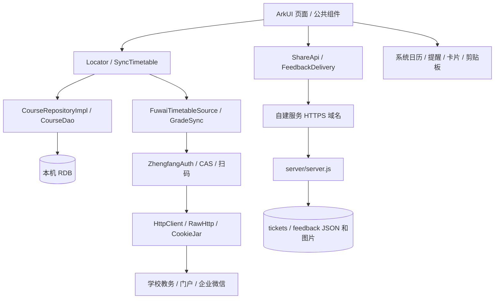

# 项目总地图

核对日期：2026-11-14。范围是当前工作区实际文件，包含尚未提交的加固代码；不是线上运行版本或安装包的证明。入口见 [地图索引](README.md)。

## 1. 项目与技术栈

福小外是课程表应用。手机直接连接学校教务与统一认证服务，获取课表、成绩、考试；自建服务负责课表口令分享、反馈和管理仪表盘。

| 部分 | 真实技术/配置 | 源码依据 |
|---|---|---|
| 鸿蒙应用 | ArkTS `.ets`、ArkUI 声明式页面、Stage 模型；单 `entry` 模块 | [module.json5](../../entry/src/main/module.json5)、[模块构建配置](../../entry/build-profile.json5) |
| 设备 | `phone`、`tablet`；主 Ability 为 `singleton`、`exported` | [module.json5](../../entry/src/main/module.json5) |
| 系统能力 | RDB、preferences、文件、HUKS、HTTP/TCP、zlib、WebView、日历、提醒、桌面卡片 | [模块地图](MODULE_MAP.md)、[状态地图](STATE_MAP.md) |
| 自建后端 | 原生 Node.js `http`，CommonJS；`fs`、`crypto`、`zlib` 等内置模块，无 Web 框架 | [server.js](../../server/server.js) |
| Web 内容 | 静态 HTML/CSS，仪表盘内联 JavaScript + `fetch`；下载引导页由独立 Node 服务监听 18080 | [dashboard.html](../../server/dashboard.html)、[site/index.html](../../server/site/index.html)、[download-center/index.html](../../server/download-center/index.html)、[download-center/server.js](../../server/download-center/server.js) |
| 构建 | Hvigor `appTasks` / `hapTasks`、PowerShell、Java 签名工具，模板打包分支优先使用 Python | [工程任务](../../hvigorfile.ts)、[模块任务](../../entry/hvigorfile.ts)、[构建地图](BUILD_MAP.md) |
| 测试 | Node.js 内置 test runner；ArkTS 经本机 SDK TypeScript 转译，OHOS 边界提供替身；SQLite、临时文件和本地 HTTP 用于部分真实集成验证 | [ets-loader.cjs](../../tests/ets-loader.cjs)、[storage.test.cjs](../../tests/storage.test.cjs)、[server-http.cjs](../../tests/server-http.cjs) |

根 [oh-package.json5](../../oh-package.json5)、[entry/oh-package.json5](../../entry/oh-package.json5) 的 `dependencies` 均为空；不代表应用没有系统 SDK 依赖。当前目录没有 Android 源码工程；`assets/release/` 中的安卓安装包只能作为历史产物，不能据其文件名推导本工程实现。

## 2. 当前工程目录

```text
HarmonyOs/
├─ AppScope/                       应用身份、版本和应用级资源
├─ entry/
│  ├─ src/main/module.json5        权限、主 Ability、卡片扩展声明
│  ├─ src/main/resources/          页面注册、卡片配置、图标、颜色、字符串
│  └─ src/main/ets/
│     ├─ entryability/            主应用入口
│     ├─ app/di/                  Locator 服务定位与初始化
│     ├─ domain/                  模型、仓储/数据源接口、同步用例
│     ├─ data/local/              RDB/DAO、preferences、文件、加密、账号课表状态
│     ├─ data/remote/             教务抓取、认证、解析、成绩、分享、反馈
│     ├─ data/repository/         本地课程仓储实现
│     ├─ network/http/            HttpClient、RawHttp、CookieJar
│     ├─ common/                  设计 Token、时间、并发、账号版本、系统日历工具
│     ├─ pages/                   23 个注册页面
│     ├─ ui/components/           11 个公共 UI 组件
│     └─ widget/                  卡片扩展、数据组装、主动刷新、DayCard
├─ server/                        当前本地后端源码、站点、部署示例
├─ tests/                         20 个 .cjs 文件（含转译加载器）
├─ tools/                         构建、签名、验包脚本
├─ hvigor/                        Hvigor 配置
├─ build-profile.json5            工程产品、SDK 兼容目标；当前签名配置为空
├─ hvigorfile.ts                  工程任务
├─ oh-package.json5               工程元信息
├─ docs/map/                      本地图体系
├─ assets/                       设计图片、旧开发记录、历史发行文件等
├─ dist/                         已存在的旧签名产物及其他发行材料
└─ 上架材料/                     已存在的商店材料
```

盘点：`entry/src/main/ets/` 共 88 个 `.ets`；以文件数描述范围，不把空目录和备份计入模块实现。根目录单独的 `LoginPage.ets` 不在主模块的注册源码位置；实际页面是 [pages/LoginPage.ets](../../entry/src/main/ets/pages/LoginPage.ets)。`_tmp/`、`.hvigor/`、`.idea/`、旧文档和发行材料不是运行逻辑入口，本次未执行其中脚本、清理或搬移。

## 3. 启动与运行入口

| 入口 | 核心符号 | 调用与作用 |
|---|---|---|
| [EntryAbility.ets](../../entry/src/main/ets/entryability/EntryAbility.ets) | `EntryAbility.onCreate()` → `init()` | 调用 `Locator.init(this.context)`；加载 `SettingsStore`，设置 `AppStorage.dark` |
| 同上 | `onWindowStageCreate()` | `windowStage.loadContent('pages/Index')`，显示首页；不是等待所有页面业务初始化完成的屏障 |
| [ServiceLocator.ets](../../entry/src/main/ets/app/di/ServiceLocator.ets) | `Locator.init()` / `initStores()` | 共享初始化 Promise；打开 DB、注入 Store 上下文、初始化课表状态、加载凭据、认领旧数据、选择账号、绑定会话 |
| [Index.ets](../../entry/src/main/ets/pages/Index.ets) | `aboutToAppear()` / `onPageShow()` / `loadAll()` / `loadCourses()` | 创建周页、读设置/节次/课表、确保默认课表、旧演示数据迁移、按条件自动同步 |
| [EntryFormAbility.ets](../../entry/src/main/ets/widget/EntryFormAbility.ets) | `onAddForm()` / `onUpdateForm()` / `push()` | 桌面卡片独立扩展入口；恢复保存的账号及选中课表，构造并提交卡片数据 |
| [server.js](../../server/server.js) | `http.createServer()` 的异步回调 / `start()` | 校验环境凭据、准备数据目录/保留期处理、启动 HTTP 服务；路由未抽成单独的具名 handler |

必须按源码现状理解初始化顺序：当前 `Locator.initStores()` 先 `TimetableStateStore.init()`，后 `Db.selectAccount()`；这与卡片入口的顺序不同。是否需要调整属于业务修复，见 [状态地图](STATE_MAP.md)，本次仅记录。

## 4. 前后端架构与边界



- 学号密码登录、验证码、扫码后换票的学校链路在手机端完成；当前后端没有代理学校登录/成绩的路由。
- `HttpClient` 包装系统 HTTP；`RawHttp` 用 TCP 处理需要观察中间重定向的 HTTP。两条网络栈存在用途差异，见 [API 地图](API_MAP.md)。不能因为分享 API 是 HTTPS，就把学校 HTTP 链路描述为已加密传输。
- 课程、成绩、凭据、个人资料和设置主要在本机；主动分享和反馈会上传指定数据。具体归属、保留与清理见 [数据库地图](DATABASE_MAP.md)。
- Node 服务默认监听回环地址和 8080，nginx HTTPS 反代及 systemd 非 root 运行由本地示例描述。真实公网部署、证书和运行版本均待确认，本次没有访问生产。
- 单独的 [下载引导服务](../../server/download-center/server.js) 监听公网 18080，仅服务发布页和图标；2026-11-16 已安装为 `fxw-download-center.service`，与原 8080 分享/反馈服务进程隔离。VPS 本机验证通过，外网端到端访问仍待确认，细节见 [API 地图](API_MAP.md) 与 [构建地图](BUILD_MAP.md)。

## 5. 三条核心调用链

1. 课表：`LoginPage.doLogin()` → `Locator.syncAndSave()` → `SyncTimetable.run()` → `FuwaiTimetableSource.fetch()` → `ZhengfangAuth.login()` / `fetchTimetable()` → `parseTimetable()` → `CourseRepositoryImpl.replaceAll()` → `Db.transaction()` → `CourseDao.clear()` / `insertAll()` → `Locator.persist()`。
2. 成绩：`Locator.persist()` → `gradesInBackground()` 或 `GradePage.refresh()` → `Locator.syncGrades()` → `GradeSync.quiet()` / `run()` → `SchoolTraffic.run()` → 学期与分页读取 → `GradeCacheStore.save()`；页面先按当前账号读缓存。
3. 分享/反馈：`Index.makeShareCode()` → `uploadShare()` → `/api/share`；`Index.queryImport()` → `fetchShare()` → `applyImport()`；`FeedbackPage.submit()` → `FeedbackStore.push()` → `FeedbackDelivery.send()` → `uploadFeedback()` → `/api/feedback`。

更细的函数和状态条件分别在 [模块地图](MODULE_MAP.md)、[页面地图](PAGE_MAP.md)、[状态地图](STATE_MAP.md)。

## 6. 维护与验证边界

- 本轮只建立文档，未运行构建、测试、签名、安装、网络请求或部署；代码可编译性和真实设备效果仍需后续验证。
- 当前版本声明为 0.1.1，但 `dist/` 尚有 0.1.0 命名的签名包，`assets/release/` 还有其他历史命名。版本声明不等于最新安装包已成功生成，见 [构建地图](BUILD_MAP.md)。
- 上一轮加固处于暂停状态。已发现的认证取消恢复、提醒创建期间账号切换、清理遇到日历权限失败等边界要以当前实现继续核对，不能把设计意图写成已完成保证。
- 本文件更新触发：增加/删除模块、修改 Ability/入口、改变客户端与后端职责、变更技术栈。同步更新 [MODULE_MAP.md](MODULE_MAP.md)、[BUILD_MAP.md](BUILD_MAP.md) 及 [README.md](README.md)。

## 2026-11-14 后续发布状态

前述“本轮只建立文档”指初次地图任务；后续0.1.1签名与模拟器记录见BUILD_MAP。本次后台v2已按明确授权部署：`server/server.js` → `admin-console.js`管理扩展；`dashboard.html` → `admin.js/admin.css`；Logo沿用`server/site/img/icon.png`。五工作区为口令、反馈、探针、告警、操作记录，文件和函数入口见MODULE_MAP/PAGE_MAP。

线上沿用部署前公开业务版本，只插入管理扩展，工作区其他后端加固尚未因此上线。8份原口令逐文件SHA256一致，13条旧反馈授权清空；部署及恢复证据见 [交付记录](../admin-console-20261114.md)。
